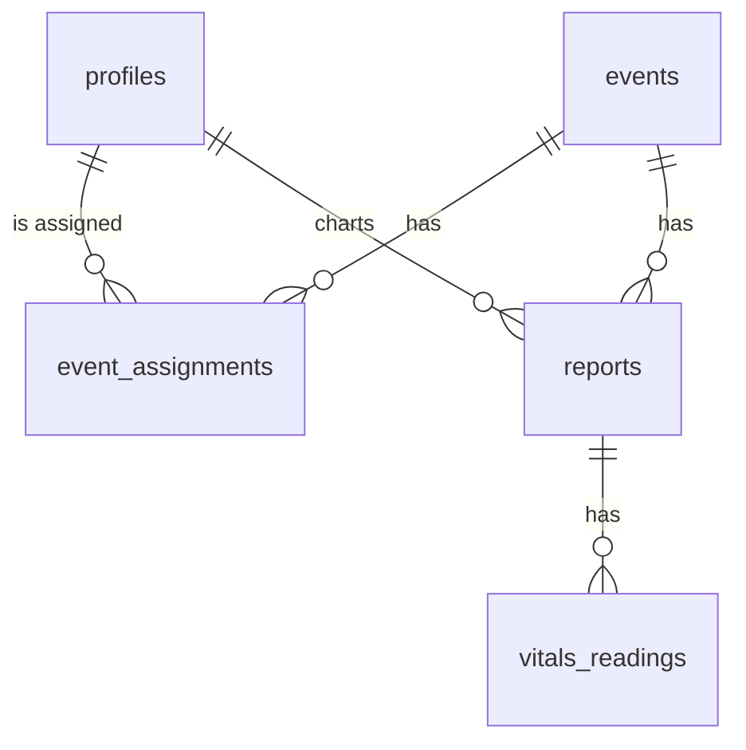

# RedAid — Project Documentation

**Digital Patient Care Report charting for the VSU College Red Cross Youth**

| | |
|---|---|
| **Type** | Progressive Web App (works in a phone browser, installable to the home screen) |
| **Built for** | Visayas State University (Baybay) — College Red Cross Youth |
| **First live use** | University intramurals |
| **Stack** | Next.js (App Router) · TypeScript · Tailwind CSS · Supabase (Auth, Postgres, Storage) · Vercel |
| **Status** | Core screens converted and the database designed; integration and testing in progress (see [Project status](#12-project-status)) |

---

## 1. The problem

At university events, first aiders record every patient on a paper **Patient Care Report** (chief complaint, patient details, repeated vital-sign checks, care given, signature). On paper:

- Forms get lost, damaged, or become unreadable (handwriting, rain, sweat).
- Nobody can see how many patients were treated, or what they were treated for, until someone manually counts the paper afterwards.
- A Team Leader can't review a report without physically collecting it.
- There is no reliable record of *who was actually on duty* and allowed to treat patients.
- Reports are hard to search, hard to total, and hard to keep for the next event.

## 2. The solution

RedAid replaces the paper form with a phone-friendly web app that mirrors the paper form field by field, and adds the oversight the paper process lacked:

- **Charters** (first aiders) chart patients on their phones, step by step.
- A **Team Leader** on duty **approves** each Charter for that event before they can chart. No approval, no charting.
- The Team Leader **reviews** submitted reports and adds notes.
- An **Admin** sets up events and people, and can see every report and statistic.
- Everything is stored in one searchable place, protected so that people only see what their role allows.

### What RedAid is *not* (current scope)

- It is not a public website: there is no self-registration. Accounts are created by an Admin.
- It does not replace professional medical records or give medical advice; it digitizes the chapter's own report form.
- Offline charting is a planned stretch goal, not part of the first release (see [Roadmap](#13-roadmap-and-known-gaps)).

---

## 3. Users and roles

| Role | Who | What they can do |
|---|---|---|
| **Admin** | Chapter officers managing the system | Create/edit/delete events, assign Team Leaders and Charters to events, create and deactivate accounts, view all submitted reports, add admin notes, see statistics |
| **Team Leader** | The person leading a duty at an event | See their duties, **approve or revoke Charters** for an event, view and **review** reports from their duties |
| **Charter** | A first aider on duty | See assigned events, **chart new patient reports** (only when approved for today's duty), view their own reports |

**Two layers of role.** Every account has a platform role (`admin` or `user`). Non-admins also have a *duty role* (`team_leader` or `charter`) set by an Admin. The app uses the combination to decide which area of the site a person lands in (`/admin`, `/team-leader`, `/charter`).

### The verification gate (the core rule)

> A Charter can only create a patient report if a Team Leader has **verified them for an event that is happening today**.

- Verification is **per event**, not permanent.
- The rule is enforced **in the database**, not only in the interface, so it cannot be bypassed by editing the page.
- Revoking approval immediately blocks further charting for that event.
- Approvals can be changed for today's and future events, never for past ones.

---

## 4. How it works (a typical event)

1. **Before the event — Admin** creates the event (title, date, time, location), assigns at least one Team Leader and the Charters who will be on duty.
2. **Event day — Team Leader** opens *Verify*, sees the assigned Charters, and taps **Approve** for each one who has actually reported for duty.
3. **During the event — Charter** sees "Approved — you can chart" on their home screen and taps **New Report**. A three-step form follows:
   1. *Patient & complaint* — chief complaint, name, age, sex, address
   2. *Vitals* — one or more checks (time, temperature, pulse, respiratory rate, blood pressure, SpO₂)
   3. *Care given & signature* — what was done, and the first aider's drawn signature
4. **After submitting — Team Leader** opens *Duty Reports*, reads the report, writes notes, and taps **Mark as Reviewed**.
5. **Anytime — Admin** watches totals on the dashboard, opens any report, and can leave separate admin notes.

Report status moves: `draft` → `submitted` → `reviewed`. Admins never see unfinished drafts.

---

## 5. Features by role

### Authentication (everyone)
- Email + password login
- Forgot / reset password by email link
- Automatic redirect to the right area for the person's role
- A holding screen for accounts that have no duty role yet

### Admin
- **Dashboard** — total reports, reports pending review, active staff, events this month, latest submissions
- **Calendar** — month view of all events; create events; open an event to edit or delete it
- **Event detail** — details, assigned Team Leaders, assigned Charters and each Charter's verification status
- **Manage Accounts** — search/filter, activate/deactivate, add new Team Leaders and Charters (by email invite, or with a temporary password)
- **Account profile** — duty history and (for Charters) report history
- **All Reports** — search by patient, filter by status and event; open any report; add **admin notes**

### Team Leader
- **Dashboard** — today's duty (or next duty), charters and their approval status, number of reports on the duty
- **Verify Charters** — approve / revoke each Charter
- **Duty Calendar** — only duties they lead; shortcut to verify
- **Duty Reports** — every report from events they lead; open one to review
- **Report review** — read-only report plus review notes and **Mark as Reviewed** (recorded with reviewer and time)

### Charter
- **Home** — duty status banner (no duty / waiting for approval / approved), upcoming events, recent reports
- **New Report** — the 3-step charting form with drawn signature (disabled until approved)
- **My Reports** — all of their reports, filter by status
- **Calendar** — events they are assigned to
- **Report view** — read-only report, including the Team Leader's review

---

## 6. The Patient Care Report (data captured)

Mirrors the A5 paper form.

| Section | Fields |
|---|---|
| Event | Event title, date, location (taken from the event) |
| Complaint | Chief complaint |
| Patient | Name, age (whole number, 0–130), sex (M/F), address |
| Vitals (repeatable) | Time, temperature (°C), pulse rate (bpm), respiratory rate (/min), blood pressure (systolic/diastolic, mmHg), SpO₂ (%) |
| Care | Care given |
| Sign-off | Signature (drawn on screen), first aider (the Charter), Team Leader on duty |
| Review | Review notes, reviewed by, reviewed at; separate admin notes |

---

## 7. Architecture

```
Phone / laptop browser
        │
        ▼
  Next.js app (Vercel)  ──────────────►  /api/admin/accounts  (server only, uses secret key)
        │  supabase-js (public key + the user's login)
        ▼
  Supabase
  ├─ Auth      — emails, passwords, sessions
  ├─ Postgres  — tables + Row Level Security + database functions
  └─ Storage   — signatures (private), profile photos (private)
```

**Key ideas**

- **The browser never gets the secret key.** The only place that uses Supabase's *service-role* key is one server route that creates accounts, and it first checks that the caller is an Admin.
- **The database is the gatekeeper.** Row Level Security (RLS) policies decide who can read or write each row; the interface only reflects what the database allows.
- **Sensitive actions go through narrow database functions** (approve a charter, review a report, submit a report, save an event) instead of open edit permissions.
- **Passwords belong to Supabase Auth.** The app's own `profiles` table holds name, roles and photo, keyed by the same user id.

### Folder structure (`src/`)

```
app/
  login/  forgot-password/  reset-password/   page.tsx          Public auth screens
  page.tsx                                                      Routes people to their area
  admin/              page, reports/, reports/[id], calendar/, events/[id], accounts/, accounts/[id]
  team-leader/        page, calendar/, reports/, reports/[id], verify/
  charter/            page, calendar/, reports/, reports/[id], report/new/
  api/admin/accounts/route.ts                                   Server-only account creation
components/           Shared UI (PageHeader, StatCard, ReportList, dialogs, report/Step*.tsx, …)
  ui/                 Base components (button, input, dialog, toast, …)
contexts/AuthContext.tsx                                        Logged-in user + profile
lib/
  supabase.ts         Browser Supabase client
  roles.ts            Role names, home paths, navigation per role
  formatting.ts       Date/time helpers, status colours
  storage.ts          Signature + avatar upload/download helpers
  useData.ts          Small data-loading hook
  data/               All database calls: reports.ts, events.ts, profiles.ts, accounts.ts
types/                auth.ts, domain.ts, report-form.ts
supabase/             SQL files (run in order, see Setup)
```

Pages never talk to the database directly — they call functions in `lib/data/`, so database details live in one place.

---

## 8. Data model

| Table | Purpose | Key columns |
|---|---|---|
| `profiles` | One row per person (keyed to their Supabase login) | `id`, `email`, `full_name`, `role` (admin/user), `duty_role` (team_leader/charter), `active`, `photo_url` |
| `events` | A duty/event | `title`, `date`, `time`, `location`, `description`, `created_by` |
| `event_assignments` | Who is on duty for which event | **PK (`event_id`, `user_id`)**, `duty_role`, `verified`, `verified_at`, `verified_by` |
| `reports` | One row per patient | `event_id`, `charter_id`, `team_leader_id`, patient fields, `care_given`, `signature_url`, `status`, `review_notes`, `admin_notes`, `reviewed_by`, `reviewed_at`, `submitted_at` |
| `vitals_readings` | One row per vitals check | `report_id`, `time_taken`, `temp`, `pr`, `rr`, `bp_systolic`, `bp_diastolic`, `spo2` |



**Design choices**

- `verified` lives on the *assignment*, so approval is per person **per event**.
- Patient reports use `ON DELETE RESTRICT` for events and charters: patient records can't disappear because an event or account was deleted. Accounts are **deactivated**, not deleted; events that already have reports cannot be deleted.
- Each vitals check is its own row, matching the repeating row on the paper form.

---

## 9. Security model

| Concern | How it is handled |
|---|---|
| Who can see what | Row Level Security on every table. Charters see only their own reports; Team Leaders see submitted/reviewed reports on events they lead; Admins see all submitted/reviewed reports. |
| Drafts | Visible only to the Charter who wrote them. |
| Charting without approval | Blocked by the insert policy: must be a verified Charter on an event dated **today** (Philippine time). |
| Approving charters | `set_charter_verified()` — Team Leaders of that event only; today or future only; only for assigned Charters. |
| Reviewing reports | `review_report()` — Team Leaders of that event only; submitted reports only; once. Reviewer and time are written by the database. |
| Becoming admin | No policy lets a user change their own role. Only Admins can edit profiles. |
| Account creation | Server route checks the caller is an Admin using the database, then uses the secret key. |
| Signatures | Private storage bucket; readable by the author, the Team Leader of that event, and Admins, via short-lived links. |
| Secrets | Service-role key is server-only (no `NEXT_PUBLIC_` prefix) and never committed. |
| Duplicate submits | The report id is created once per form; a retry cannot create a second copy. |

---

## 10. Setup guide

### Prerequisites
Node.js 20+, a GitHub account, a Supabase project, (for deployment) a Vercel account.

### 1. Install
```bash
npm install
npm install @supabase/supabase-js @supabase/ssr clsx tailwind-merge class-variance-authority \
  @radix-ui/react-slot @radix-ui/react-label @radix-ui/react-toast lucide-react dayjs
npx shadcn@latest add dialog alert-dialog select switch textarea checkbox
```
(Do not overwrite the project's own `button`, `input`, `label`.)

### 2. Environment variables — `.env.local` (never commit this file)
```
NEXT_PUBLIC_SUPABASE_URL=...            # Supabase → Settings → API
NEXT_PUBLIC_SUPABASE_ANON_KEY=...       # the "anon" key (safe for the browser)
SUPABASE_SERVICE_ROLE_KEY=...           # the "service_role" key — SERVER ONLY, keep secret
```
Add the same three to Vercel → Project Settings → Environment Variables.

### 3. Database — run in the Supabase SQL editor, in this order
1. `profiles` table (from the auth setup notes)
2. `supabase/batch2-core-tables.sql` — tables, admin permissions
3. `supabase/batch3-charter-policies.sql` — charter permissions, the verification gate, `submit_report()`, signatures bucket
4. `supabase/batch6-teamleader-policies.sql` — Team Leader permissions, `set_charter_verified()`, `review_report()`
5. `supabase/batch7-events-avatars.sql` — `save_event()`, avatars bucket

### 4. Create the first Admin
Supabase → Authentication → Users → *Add user*, then run the commented "first admin" block at the end of `batch2-core-tables.sql` with that email.

### 5. Auth URLs
Supabase → Authentication → URL Configuration: set **Site URL** to the deployed address and add `http://localhost:3000/**` and the Vercel address (`…/**`) to **Redirect URLs**, so invite and reset emails land on the right page.

### 6. Run
```bash
npm run dev      # http://localhost:3000
```

### Adding people
Admin → Manage Accounts → *Add New*. Either an **email invite** (the person sets their own password) or a **temporary password** (no email is sent — useful when adding many people, because Supabase's built-in email sending allows only a few messages per hour).

---

## 11. Testing

- The SQL (policies and functions) was executed on a local Postgres with test users and **52 scenarios** passed, including: an unverified Charter is blocked; approval unlocks charting and revoking blocks it again; future/past events can't be charted; a retried submit makes no duplicate; Charters can't read others' reports; Team Leaders can't edit patient data; nobody can promote themselves to Admin or approve themselves; events with reports can't be deleted.
- All TypeScript compiles in strict mode against stand-ins for not-yet-converted components.
- **Not yet done:** running the full app in a browser against a real Supabase project, signature upload/display end-to-end, account creation through the real server route, and a phone test. Do these first (see checklist below).

### Suggested manual test script
1. Admin creates a Team Leader, two Charters, and an event today assigning all three.
2. Log in as Charter A → home says *Waiting for Team Leader approval*, New Report disabled.
3. Log in as the Team Leader → Verify → approve Charter A.
4. Charter A charts a patient (2 vitals checks, signature) → submits.
5. Team Leader opens Duty Reports → reviews → marks reviewed.
6. Admin opens All Reports → sees it; adds an admin note.
7. Charter B (not approved) still cannot chart. Revoke Charter A → they can't chart again.
8. Repeat on a phone.

---

## 12. Project status

| Area | State |
|---|---|
| Database design, policies, functions | Written and tested locally |
| Auth screens | Converted from the Base44 prototype |
| Admin, Team Leader, Charter pages | Converted from the prototype to typed Next.js |
| Shared components, dialogs, toasts | Converted |
| App shell (navigation/sidebar), route protection by role | **Pending** (needs the prototype's layout files) |
| Theme (colours, heading font) | **Pending** (needs the prototype's `index.css` / Tailwind config) |
| Settings / profile pages, notifications | Not yet converted |
| Running end-to-end on real Supabase | **Not yet done** |
| Offline mode | Not started |

## 13. Roadmap and known gaps

**Before the intramurals (must-have)**
1. Add the app shell and role-based route protection.
2. Bring over the theme; run the full manual test on real devices.
3. Create real accounts for the team; deploy to Vercel.
4. Dry run with the team the day before.

**Next (should-have)**
- Settings: edit own name/photo/password (must only allow name/photo — never role).
- Notifications (e.g. "you've been approved", "your report was reviewed").
- Export/print a report as PDF in the paper form's layout.

**Stretch**
- **Offline report creation** (IndexedDB via Dexie + service worker) with automatic sync when the connection returns — scoped to creating reports only.
- Per-event statistics (patients by complaint, by hour).

**Known limitations**
- The verification gate uses **Philippine time** (`Asia/Manila`), set in the database.
- Only one Team Leader is stored as the report's "team leader" (the first on the event), but *all* Team Leaders of the event can see and review its reports.
- The signature box is sized when the page loads; rotating the phone mid-signature can look stretched (the saved image is fine).
- Supabase's built-in email sending is rate-limited; use temporary passwords or custom SMTP for bulk account creation.

---

## 14. Glossary

| Term | Meaning |
|---|---|
| **PWA** | Progressive Web App — a website that behaves like an app on a phone |
| **Charter** | First aider who charts patients (called "First Aider" in early drafts) |
| **Team Leader** | The Charter-supervising person on duty; approves Charters, reviews reports |
| **Duty / Event** | A scheduled occasion with assigned staff |
| **Verification / approval** | A Team Leader allowing a Charter to chart for one event |
| **RLS** | Row Level Security — database rules deciding who can read/write each row |
| **RPC function** | A named database function the app calls for a sensitive action |
| **Service-role key** | A Supabase master key; server-only, never in the browser |
